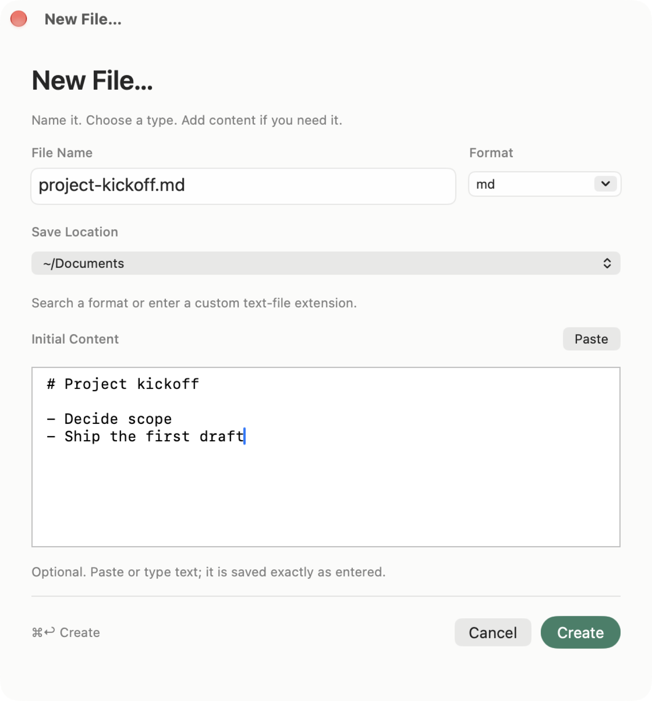

<h1 align="center">FileMint</h1>

<strong>FileDraw opens your folders from the screen edge.</strong> Find and preview files from the Mac app you’re already using. Create files and run everyday tools from Finder.

<strong>English</strong> ｜ <a href="README.zh-CN.md"><strong>简体中文 →</strong></a>

<a href="https://github.com/FileMintApp/FileMint/releases/latest"><strong>Get the DMG</strong></a> · <a href="#filedraw">FileDraw demo</a> · <a href="https://filemintapp.github.io/FileMint/en/">Website</a> · <a href="docs/INSTALL.md">Installation help</a> · <a href="https://github.com/FileMintApp/FileMint/issues">Report an issue</a>

M-series Macs · macOS 13+ · Apple-notarized DMG

## FileDraw

Open Downloads or a project folder from the sidebar. Pin the drawer to keep it visible when you switch apps. FileDraw browses one open, authorized folder at a time.

Open the drawer, browse and filter a folder, preview a file with Quick Look and open its actions. Then close the drawer and bring it back from the screen edge.

https://github.com/user-attachments/assets/bd80a10b-bd88-4e44-87bc-08375e12ef22

[Watch on the website](https://filemintapp.github.io/FileMint/en/#file-drawer-demo) · [MP4 file](website/public/videos/file-drawer-en.mp4) · [Setup and shortcuts](https://filemintapp.github.io/FileMint/en/guide.html#file-drawer)

| Shortcut | In FileDraw |
| --- | --- |
| `⌃⌥D` | Open the drawer while FileMint is running. |
| `⌘F` | Find items by name in the open folder. |
| `Space` | Preview the selected file with Quick Look. |
| `⌘K` | Show actions for the selection, such as copying a path, moving an item or choosing an app to open it. |
| `⌘W` | Close the drawer. |

## Install and enable FileDraw

Current stable installers support **M-series Macs on macOS 13.0 or later**. They are Developer ID signed, Apple notarized and stapled.

1. [Download the latest DMG](https://github.com/FileMintApp/FileMint/releases/latest), drag FileMint into Applications and open it.
2. Go to **Extensions → File Drawer** and turn it on. FileDraw starts off. Click **Open File Drawer** or use the default shortcut `⌃⌥D`, then grant access to your chosen folder when prompted.
3. To use the Finder context menu, enable the Finder extension and set up your working folders. See the [first-time Finder setup](https://filemintapp.github.io/FileMint/en/guide.html#complete-the-first-time-setup).

For a fresh installation, the [official FileMint Homebrew tap](https://github.com/FileMintApp/homebrew-tap)
provides `brew install --cask filemintapp/tap/filemint`.

See the [installation notes](docs/INSTALL.md) for older updaters, Intel compatibility and verifying a download. Apple accepted the 0.5.3 DMG for notarization after publication; that download has no stapled ticket and needs network access for Gatekeeper to retrieve it.

[Latest stable release notes](https://github.com/FileMintApp/FileMint/releases/latest) · [Website source](website/)

## Create files from Finder

Right-click an empty area in a configured Finder folder and choose **New File → Markdown (.md)**, or pick another enabled template. Use **New File…** to set the filename, destination and starter content together. The same panel is available in FileMint and its menu bar.

  

- **Reusable templates.** Save multiple templates per format, choose a default and preview text or supported Office output. Import your own Word and Excel documents to create independent copies, or share templates in `.filemint-templates` packages.
- **Create from the clipboard.** Review copied plain text before saving it, or preview and name a copied image to save it as PNG.
- **Create and open.** Choose the app that opens your saved file, in the template or for this creation.

See the New File panel

  

Press `⌘↩` to create or `Esc` to cancel. Quick creation numbers duplicate names by default. The custom panel asks before replacing an existing file and saves custom suffixes as UTF-8 text.

## More in FileMint

- **Quick Search.** Enable the optional global shortcut in General to find creation actions, enabled templates, favorites and settings. [Shortcuts and Raycast](docs/SHORTCUTS_AND_LAUNCHERS.md) can open a prefilled draft or Quick Search on macOS 13.3 or later.
- **File & Folder Tools.** Preview and rename 2–1,000 items in one folder on local, writable APFS, with undo and interruption recovery. Inspect file information, calculate SHA-256 and other checksums, copy complete supported text, and manage items and hidden file visibility. [File & Folder Tools guide](https://filemintapp.github.io/FileMint/en/guide.html#enable-file-folder-tools-when-needed)
- **Image tools.** Convert, compress, resize or stitch images, generate icons, extract text with OCR and remove private metadata. FileMint saves a separate result and keeps the source. [Image tools guide](https://filemintapp.github.io/FileMint/en/guide.html#process-images-and-extract-text)
- **Open with App and Favorite Locations.** Add your editor or terminal to Finder and save files and folders you want to find again. [User guide](https://filemintapp.github.io/FileMint/en/guide.html)

## Privacy and permission boundaries

- Filenames, paths, content, images and OCR results are never uploaded.
- FileMint does not crawl folders in the background, monitor the clipboard or keep image-processing history.
- Finder actions operate only on the current local selection inside an authorized scope.
- Creation and image processing work offline. The main app reaches GitHub only for update checks or downloads; the Finder extension stays offline.
- Enable the Finder extension in macOS System Settings and manage saved folder grants in FileMint's File Access settings.

Read the complete [privacy policy](PRIVACY.md).

## Roadmap

These are unfinished directions only; the list changes with real use and feedback.

<!-- #region roadmap -->

### Templates and naming

- [ ] **Filename rules** — Build names from dates, project names and other fields, with a preview of the result.

### Folders and tool integrations

- [ ] **Project folder templates** — Create a familiar folder structure and starter files in one action.
- [ ] **Shortcuts and Raycast setup** — Verify that first-time users can set up and repeat the draft workflows available since 0.8.2.

### Finding templates and everyday use

- [ ] **Template groups and favorites** — Group templates by purpose, pin favorites and find them through search.
- [ ] **First-file walkthrough** — Follow clear steps from enabling the extension and authorizing a folder to creating your first file.
- [ ] **Troubleshooting and compatibility notes** — Get specific help when menus or creation fail, with verified external-drive notes.

### Installation and distribution

- [ ] **Homebrew upgrade and migration** — Verify upgrade, migration from a manual installation and removal on an isolated Mac.

<!-- #endregion roadmap -->

Implementation notes and completion criteria live in the [implementation roadmap (Chinese)](docs/ROADMAP.md). Share recurring file-creation needs through [Issues](https://github.com/FileMintApp/FileMint/issues), or contribute templates, translations and reproduction steps.

## Special Thanks

Thank you to [阿逼 (@bibinocode)](https://github.com/bibinocode) for helping with FileMint's Developer ID signing and Apple notarization submission.

## Buy me a coffee

Optional donations are welcome if FileMint saves you a few interruptions. Personal and non-commercial use is free; features do not depend on donations. A donation does not purchase commercial rights.

  &nbsp;&nbsp;
  

## Source and license

Copyright: **XiaoDaiGua-Ray**. Developers: **XiaoDaiGua-Ray and GPT-Astra**.

**Personal and non-commercial use is free. Commercial use requires prior written authorization or a separately issued paid commercial license.**

| Use | Permission |
| --- | --- |
| Personal, educational and research use without commercial purpose | Free |
| Non-commercial forks, modifications and redistribution | Free; retain license and copyright notices |
| Business workflows, client work and paid services | Separate written authorization or paid commercial license |
| Commercial derivatives, paid distribution or product integration | Separate written authorization or paid commercial license |

FileMint uses its own [Non-Commercial Source License](LICENSE), **not MIT**. Source availability does not grant unrestricted commercial rights. See [commercial licensing](docs/COMMERCIAL_LICENSE.md).
Contributors can start with [development](docs/DEVELOPMENT.md), the [SPEC](specs/SPEC.md) and [acceptance evidence](docs/ACCEPTANCE.md).
