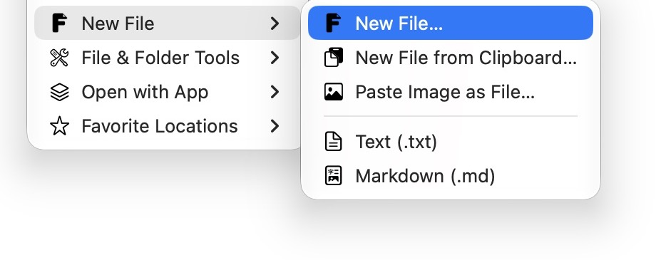
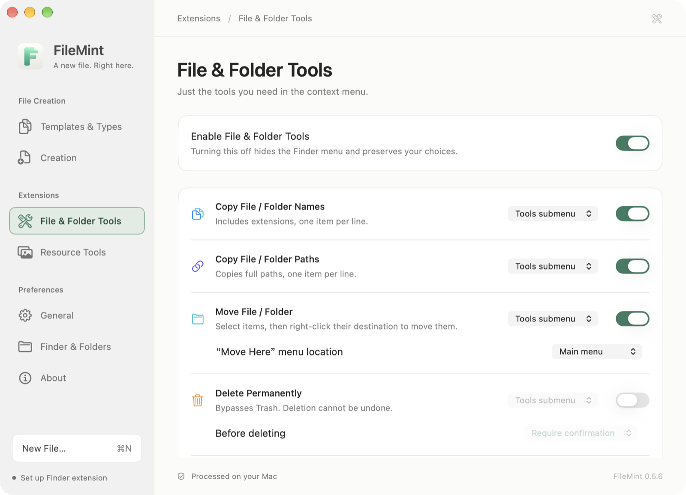

<h1 align="center">FileMint</h1>

<strong>Create files from Finder's right-click menu.</strong> Start a Markdown note, Word document or Excel workbook in the folder you already have open.

<strong>English</strong> ｜ <a href="README.zh-CN.md"><strong>简体中文 →</strong></a>

<a href="https://github.com/FileMintApp/FileMint/releases/latest"><strong>Get the DMG</strong></a> · <a href="docs/INSTALL.md">Installation help</a> · <a href="https://filemintapp.github.io/FileMint/en/">Website</a> · <a href="website/">Website source</a> · <a href="https://github.com/FileMintApp/FileMint/issues">Report an issue</a>

M-series Macs · macOS 13+ · Apple-notarized DMG

Right-click the background of a Finder folder configured in FileMint, then choose **New File → Markdown (.md)** to create a file there. Choose **New File…** when you want to set the filename and starter content first.

  

Example Finder menu; available templates and optional tools depend on your settings.

FileMint is a native **macOS Finder extension** with reusable templates and optional tools for batch renaming, SHA-256 checksums, image compression and OCR. File creation and processing run on your Mac.

[What's new in the latest stable release](https://github.com/FileMintApp/FileMint/releases/latest)

## Features

- **Quick Search**: Find creation actions, enabled templates, favorites and settings from one panel; optionally enable a global shortcut in General.
- **Shortcuts and Raycast**: Open a prefilled draft or Quick Search. Requires macOS 13.3 or later; see the [setup guide](docs/SHORTCUTS_AND_LAUNCHERS.md).
- **Copy File Contents**: Copy complete supported text files from Finder, retaining whitespace and line endings. Enable it under File & Folder Tools.
- **Batch Rename**: Preview and rename 2–1,000 items in one directory on local, writable APFS, with undo, interrupted-operation recovery and no overwriting of existing items.
- **File Info and checksums**: Inspect one ordinary file, explicitly calculate four supported digests, and copy or compare results.
- **Copy and preview templates**: Start with a copy of an existing template and optionally inspect text output or an Office preview supported by the system.
- **Import and export templates**: Back up, move or share templates in `.filemint-templates` packages, reviewing conflicts before import.
- **Create and Open**: Continue in an app chosen for the template or this creation; opening failures preserve the saved file.
- **New File from Clipboard**: Explicitly read one plain-text item, then review the name, destination and content before creating a file.
- **Open with App**: Add your go-to apps to Finder and open selected items or the current folder with them.
- **Paste Image as File**: Preview and name a copied screenshot or image, then save it as PNG.
- **Multiple templates per format**: Keep separate content and filenames for one format, with a configurable default template.
- **Word / Excel templates**: Create blank `.docx` and `.xlsx` files from built-in templates, or import your own documents and create independent copies with their formatting and content intact.
- **Toggle Hidden Files**: Change Finder's display from its context menu without changing file attributes.

## Why FileMint

| What matters | How FileMint approaches it |
| --- | --- |
| Native experience | Swift + AppKit + SwiftUI; native menus, windows and editing without an embedded web runtime. |
| Small and focused | Small footprint, no account, no subscription and no background folder crawl. |
| Local performance boundary | File creation, image processing and OCR run on your Mac instead of a remote service. |
| Finder context | Right-click the desktop or an authorized folder; the current location is the destination context. |
| Opt-in extensions | File Tools and Resource Tools start off and never disturb the existing New File menu. |

## See the workflow

### 1. Create from a Finder folder

The installed-build example above shows **New File** and its submenu in a configured folder. Choose an enabled template for quick creation, or open **New File…** to review the filename and content first.

### 2. Keep the context when you create

Set the full filename, suffix, destination and starter content before creation. Enter `project-kickoff.md`, paste the first Markdown lines and create it without an empty-file detour.

  

The creation panel supports:

- `⌘↩` to create and `Esc` to cancel; Return inserts a newline in the editor.
- A full filename and synchronized extension selector; custom suffixes remain UTF-8 text.
- Automatic numbering for quick creation and confirmation before custom replacement.
- Literal multiline text, Unicode, spaces and template-looking tokens.

### 3. Seven image Resource Tools

Select an image in Finder and open Resource Tools, or choose a local image explicitly from the app:

- **Convert Image**: JPEG, PNG, HEIC and TIFF.
- **Compress Image**: MozJPEG for JPEG, lossless PNG / TIFF encoding and the system HEIC encoder. Keep originals and dimensions, save successful results and show actual sizes.
- **Resize Image**: preserve proportions, batch resize and never enlarge the source.
- **Generate Icons**: ICNS, ICO and PNG size sets.
- **Stitch Images**: horizontal or vertical layouts with preview and ordering.
- **Extract Text**: system OCR with editable, copyable and savable results.
- **Remove Private Metadata**: Clear GPS, capture time and device metadata, then verify and save a separate copy while preserving the original.

  

The resource example uses longmao.navigator.png; preview, destination and original preservation are visible in the panel.

### 4. File & Folder Tools

The module starts off. Enable the actions you need and choose their Finder menu positions. The [user guide](https://filemintapp.github.io/FileMint/en/guide.html#enable-file-folder-tools-when-needed) covers copying names and paths, moving items, permanent deletion, AirDrop, and Finder aliases.

  

Use **New File…** in the app or menu bar to create a file without Finder integration. See the [user guide](https://filemintapp.github.io/FileMint/en/guide.html) for settings, shortcuts and troubleshooting.

## Privacy and permission boundaries

- Filenames, paths, content, images and OCR results are never uploaded.
- FileMint does not crawl folders in the background, monitor the clipboard or keep image-processing history.
- Finder actions operate only on the current local selection inside an authorized scope.
- Creation and image processing work offline. The main app reaches GitHub only for update checks or downloads; the Finder extension stays offline.
- Enable the Finder extension in macOS System Settings and manage saved folder grants in FileMint's File Access settings.

Read the complete [privacy policy](PRIVACY.md).

## Install

Current stable installers support **M-series Macs on macOS 13.0 or later**. They are Developer ID signed, Apple notarized and stapled.

1. [Download the latest DMG](https://github.com/FileMintApp/FileMint/releases/latest) and drag FileMint into Applications.
2. Launch it, enable the Finder extension and authorize your working folders.
3. Return to Finder and start creating or processing images. See the [first-time setup guide](https://filemintapp.github.io/FileMint/en/guide.html#complete-the-first-time-setup) for details.

For a fresh installation, the [official FileMint Homebrew tap](https://github.com/FileMintApp/homebrew-tap)
provides `brew install --cask filemintapp/tap/filemint`.

See the [installation notes](docs/INSTALL.md) for older updaters, Intel compatibility and verifying a download. Apple accepted the 0.5.3 DMG for notarization after publication; that download has no stapled ticket and needs network access for Gatekeeper to retrieve it.

## Roadmap

These are unfinished directions only; the list changes with real use and feedback.

<!-- #region roadmap -->

### Templates and naming

- [ ] **Filename rules** — Build names from dates, project names and other fields, with a preview of the result.

### Folders and tool integrations

- [ ] **Project folder templates** — Create a familiar folder structure and starter files in one action.
- [ ] **Shortcuts and Raycast setup** — Verify that first-time users can set up and repeat the draft workflows available since 0.8.2.

### Finding templates and everyday use

- [ ] **Template groups and favorites** — Group templates by purpose, pin favorites and find them through search.
- [ ] **First-file walkthrough** — Follow clear steps from enabling the extension and authorizing a folder to creating your first file.
- [ ] **Troubleshooting and compatibility notes** — Get specific help when menus or creation fail, with verified cloud-folder and external-drive notes.

### Installation and distribution

- [ ] **Homebrew upgrade and migration** — Verify upgrade, migration from a manual installation and removal on an isolated Mac.

<!-- #endregion roadmap -->

Implementation notes and completion criteria live in the [implementation roadmap (Chinese)](docs/ROADMAP.md). Share recurring file-creation needs through [Issues](https://github.com/FileMintApp/FileMint/issues), or contribute templates, translations and reproduction steps.

## Special Thanks

Thank you to [阿逼 (@bibinocode)](https://github.com/bibinocode) for helping with FileMint's Developer ID signing and Apple notarization submission.

## Buy me a coffee

Optional donations are welcome if FileMint saves you a few interruptions. Personal and non-commercial use is free; features do not depend on donations. A donation does not purchase commercial rights.

  &nbsp;&nbsp;
  

## Source and license

Copyright: **XiaoDaiGua-Ray**. Developers: **XiaoDaiGua-Ray and GPT-Astra**.

**Personal and non-commercial use is free. Commercial use requires prior written authorization or a separately issued paid commercial license.**

| Use | Permission |
| --- | --- |
| Personal, educational and research use without commercial purpose | Free |
| Non-commercial forks, modifications and redistribution | Free; retain license and copyright notices |
| Business workflows, client work and paid services | Separate written authorization or paid commercial license |
| Commercial derivatives, paid distribution or product integration | Separate written authorization or paid commercial license |

FileMint uses its own [Non-Commercial Source License](LICENSE), **not MIT**. Source availability does not grant unrestricted commercial rights. See [commercial licensing](docs/COMMERCIAL_LICENSE.md).
Contributors can start with [development](docs/DEVELOPMENT.md), the [SPEC](specs/SPEC.md) and [acceptance evidence](docs/ACCEPTANCE.md).
