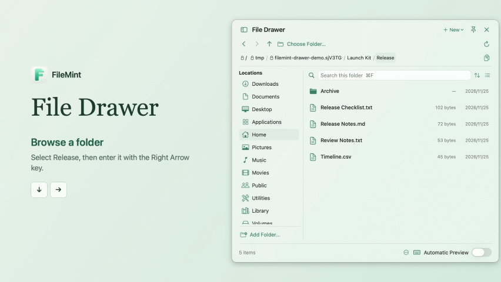

<h1 align="center">FileMint</h1>

<strong>用 FileDraw 从屏幕边缘打开常用文件夹。</strong> 在手头的 App 里查找和预览文件，也能在 Finder 里右键新建文件、处理图片。

<a href="README.md"><strong>← English</strong></a> ｜ <strong>简体中文</strong>

<a href="https://github.com/FileMintApp/FileMint/releases/latest"><strong>下载 DMG</strong></a> · <a href="#filedraw">FileDraw 演示</a> · <a href="https://filemintapp.github.io/FileMint/">官网</a> · <a href="docs/INSTALL.md">安装帮助</a> · <a href="https://github.com/FileMintApp/FileMint/issues">反馈问题</a>

M 系列 Mac · macOS 13 或更新版本 · DMG 已通过 Apple 公证

## FileDraw

从侧栏进入下载目录或项目文件夹。固定抽屉后，切换 App 时它仍留在屏幕上。FileDraw 每次只浏览当前打开且已获授权的文件夹。

  <a href="https://filemintapp.github.io/FileMint/#file-drawer-demo">
    <picture>
      <source media="(prefers-reduced-motion: reduce)" srcset="website/public/images/file-drawer-demo-en.jpg">
      
    </picture>
  </a>

[观看完整演示（英文界面）](https://filemintapp.github.io/FileMint/#file-drawer-demo) · [MP4 文件](website/public/videos/file-drawer-en.mp4) · [开启步骤和快捷键](https://filemintapp.github.io/FileMint/guide.html#file-drawer)

| 按键 | 在 FileDraw 中 |
| --- | --- |
| `⌃⌥D` | FileMint 运行时打开抽屉。 |
| `⌘F` | 在当前文件夹内按名称查找项目。 |
| `空格` | 用快速查看预览选中的文件。 |
| `⌘K` | 打开选中项的操作面板，拷贝路径、移动项目或选用 App 打开。 |

## 安装并开启 FileDraw

当前正式安装包支持 **运行 macOS 13.0 及以上的 M 系列 Mac**，使用 Developer ID 签名，通过 Apple 公证并附加公证票据。

1. [下载最新 DMG](https://github.com/FileMintApp/FileMint/releases/latest)，把 FileMint 拖入「应用程序」，然后打开。
2. 在「扩展功能 → 文件抽屉」开启 FileDraw。文件抽屉默认关闭。开启后点击「打开文件抽屉」，或按默认快捷键 `⌃⌥D`，按提示授权要访问的文件夹。
3. 要使用 Finder 右键菜单，请启用 Finder 扩展并设置常用文件夹。详细操作见 [Finder 首次设置指南](https://filemintapp.github.io/FileMint/guide.html#先完成首次设置)。

全新安装也可使用 [FileMint 官方 Homebrew tap](https://github.com/FileMintApp/homebrew-tap)：`brew install --cask filemintapp/tap/filemint`。

旧版升级、Intel 兼容性及下载校验见[安装说明](docs/INSTALL.md)。Apple 在 0.5.3 发布后接受了该 DMG 的公证；公开下载包没有附加票据，Gatekeeper 需要联网获取。

[最新正式版更新说明](https://github.com/FileMintApp/FileMint/releases/latest) · [官网源码](website/)

## 从 Finder 右键新建文件

在已配置的 Finder 文件夹空白处右键，选择「新建文件 → Markdown (.md)」或其他已启用的模板。也可选择「新建文件…」，一次填好文件名、保存位置和初始内容。FileMint 应用和菜单栏也有这个入口。

  

- **复用模板。** 同一格式可存多份模板并设置默认项，按需预览文本或系统支持的 Office 输出。可导入自己的 Word、Excel 文档来创建独立副本，也可以用 `.filemint-templates` 分享模板。
- **从剪贴板新建。** 核对拷贝的纯文本后保存，或预览并命名拷贝的截图，再保存为 PNG。
- **创建后打开。** 在模板里或本次创建时选择 App，保存后接着处理文件。

查看新建文件面板

  

按 `⌘↩` 创建，`Esc` 取消。快速新建遇到同名时默认自动编号。自定义新建在替换前询问，使用自定义后缀时保存为 UTF-8 文本。

## 更多日常工具

- **快捷搜索。** 在「通用」按需开启全局快捷键，集中查找新建操作、已启用的模板、常用位置和设置。macOS 13.3 或更新版本也可用[快捷指令和 Raycast](docs/SHORTCUTS_AND_LAUNCHERS.zh-CN.md)打开预填草稿或快捷搜索。
- **文件（夹）工具。** 在本地可写 APFS 上，预览并重命名同一文件夹内的 2–1,000 个项目，支持撤销和中断恢复。也可查看文件信息、计算 SHA-256 等校验值、拷贝受支持的文本内容，以及管理项目和隐藏文件显示。[文件（夹）工具指南](https://filemintapp.github.io/FileMint/guide.html#按需开启文件-夹-工具)
- **图片工具。** 转换、压缩、缩放、拼接图片，生成图标、提取文字或移除隐私元数据。处理结果另存，原图保留。[图片工具指南](https://filemintapp.github.io/FileMint/guide.html#处理图片与提取文字)
- **使用 App 打开与常用位置。** 把编辑器或终端加入 Finder 菜单，收藏下次还要用的文件和文件夹。[使用指南](https://filemintapp.github.io/FileMint/guide.html)

## 隐私与权限边界

- 文件名、路径、内容、图片和 OCR 结果不会上传。
- 不在后台扫描目录、不监控剪贴板，也不保留图片处理历史。
- Finder 扩展只处理当前明确选中的、位于已授权范围内的项目。
- 文件创建和图片处理离线完成；主应用只在检查或下载更新时访问 GitHub，Finder 扩展不需要网络。
- 在 macOS 系统设置中启用 Finder 扩展，在 FileMint 的「文件访问」中管理已保存的目录授权。

完整说明见 [隐私政策](PRIVACY.md)。

## 未来规划

把日常创建文件的小事继续做好。下面只列尚未完成的方向，清单会随着实际使用和反馈更新。

<!-- #region roadmap -->

### 模板与命名

- [ ] **文件名规则** — 用日期、项目名称等生成文件名，并预览最终结果。

### 目录与工具联动

- [ ] **项目目录模板** — 一次创建常用的文件夹结构和起始文件。
- [ ] **快捷指令与 Raycast 接入验收** — 验证首次使用者可以配置并重复使用 0.8.2 起提供的草稿工作流。

### 查找与日常体验

- [ ] **模板分组与常用项** — 为场景模板分组、固定常用项，并通过搜索快速找到它们。
- [ ] **首次创建引导** — 从启用扩展、授权文件夹到创建第一个文件，都有清楚的下一步。
- [ ] **故障指引与兼容性说明** — 菜单未出现或无法创建时给出具体建议，持续补充外置磁盘的验证结果。

### 安装与分发

- [ ] **Homebrew 升级与迁移** — 在隔离 Mac 上验证升级、从手动安装迁移及卸载。

<!-- #endregion roadmap -->

每项的实现思路和完成条件记录在[实施路线](docs/ROADMAP.md)。欢迎通过 [Issues](https://github.com/FileMintApp/FileMint/issues) 分享场景，也欢迎贡献模板、翻译和复现步骤。

## 特别感谢

感谢 [阿逼（@bibinocode）](https://github.com/bibinocode) 为 FileMint 的 Developer ID 签名与 Apple 公证提交提供帮助。

## 请我喝杯咖啡

如果 FileMint 少打断了你几次，欢迎随缘打赏。非商业使用无需付费，功能不因打赏与否而区别对待。打赏不等于购买商业授权。

  &nbsp;&nbsp;
  

## 源码与许可

版权：**XiaoDaiGua-Ray**。开发者：**XiaoDaiGua-Ray、GPT-Astra**。

**个人及非商业使用免费；商业使用须获得授权或单独购买商业许可。**

| 使用方式 | 授权要求 |
| --- | --- |
| 个人、学习、教育、研究等非商业使用 | 免费使用 |
| 非商业 fork、修改与再分发 | 免费，须保留许可和版权声明 |
| 企业商业流程、客户项目、收费服务 | 事先取得书面商业授权或付费商业许可 |
| 商业二次开发、收费分发或集成销售 | 事先取得书面商业授权或付费商业许可 |

本项目使用自定义[非商业源码许可](LICENSE)，**不采用 MIT**。源码公开不代表允许无授权商用。详见[商业授权说明](docs/COMMERCIAL_LICENSE.md)。

想参与改进？从[开发说明](docs/DEVELOPMENT.md)、[产品规范](specs/SPEC.md)和[验收记录](docs/ACCEPTANCE.md)开始。
